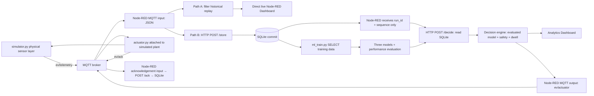

# Updated rubric audit and implementation

> Follow-up corrections: see `FIXES_REVIEW.md`. Classifiers are independent, scheduling is feasibility-aware EDF, the operating cap is 9.5 kW, and models load at startup only. Historical results below describe the previous scheduler.

## Audit of the previous draft

| Requirement | Previous code | Refactoring now implemented |
|---|---|---|
| Traditional, ensemble and deep models | One seasonal-mean model | Decision tree, random forest, three-hidden-layer ANN |
| Two independent Node-RED data paths | Dashboard downstream of service | MQTT input has two outgoing wires: direct live display and SQLite storage |
| Train from SQLite only | History generated inside `demand_model()` | `ml_train.py` SELECTs `demand_samples`; fails if insufficient stored history |
| Required MQTT topics | `gridsense/station/*` | `ev/telemetry`, `ev/actuator`; supplementary `ev/ack` |
| ML metrics | MAE only | Accuracy, precision, recall, F1, RMSE, MAE, R² per model |
| Computational metrics | Missing | Fit duration, single-row inference mean/p95, peak tracked memory, pickle size |
| Control effectiveness | No quantitative evaluation | Deadline success, energy fulfillment, unmet energy, peak load, capacity violations |
| Response time | No measured metric | Sensor timestamp to actuator application acknowledgement |
| Stability | Stale-command protection only | Six-minute assignment dwell, socket preservation and 0.25 kW rate deadband |
| Sensor layer | Simulated sensor/charger combined | Explicit sensor process plus attached actuator driver sharing one physical simulation |

## Exact Node-RED configuration

Import `node-red/flows.json` (or start with the supplied settings and flow file). Broker: `127.0.0.1:1883`, MQTT 3.1.1, QoS 1. Commands are NOT retained.

Path B uses a local Python HTTP-to-SQLite adapter (`station_store.py`); it does not require the native Node-RED SQLite add-on. `/store` returns only after commit. `/decide` accepts the record key, reads the stored row and applies trained artifacts. Stopping that service must not stop Path A. Historical replay goes to storage but is filtered out of the live EV table.

The decision engine chooses the lowest validation RMSE model that beats the constant baseline and has p95 inference latency ≤100 ms. Test scores never select the model. If no model qualifies it uses the constant baseline; before training it explicitly reports safe rule-only operation.

## Meaning of the evaluation metrics

- Regression target: requested energy during a future hourly interval. Calendar features are known before that interval. RMSE/MAE are kWh; R² is dimensionless.
- Classification target: whether that interval's actual/predicted energy is ≥30 kWh. Accuracy/precision/recall/F1 measure this threshold-based high-demand alarm, not regression accuracy. The threshold is configurable in `ml_train.py` and is not the station's instantaneous 10 kW safety limit.
- ANN: `MLPRegressor(hidden_layer_sizes=(64,32,16))`, trained by backpropagation with Adam. Scaling is fitted on training rows only. It is a multi-hidden-layer feed-forward ANN, not an LSTM.
- Split: 42 complete days; 28 train, 7 validation, 7 test. All models use identical splits. No shuffled time-series train/test split.
- Memory: peak `tracemalloc`-tracked allocations during fitting, explicitly not total process RSS or GPU memory. Model size is serialized pickle bytes. Single-row inference is warmed up, then measured 50 times.
- End-to-end response: sensor creation timestamp to actuator callback after application, covering MQTT → Node-RED → SQLite → ML/decision → MQTT. All processes run on one host. Distributed deployment requires synchronized clocks. Rejected commands are excluded from successful-response latency.
- Stability: socket occupant/on-off transitions and transitions less than six simulated minutes apart; safety/departure/completion can override dwell. Command expiry remains a separate six-simulated-minute communication-loss protection.
- Control efficacy: completed departures / departures, delivered energy / required energy, unmet departure energy, peak site kW, and capacity violation samples. Before departures occur the ratios are null, not a fabricated success rate.

## Verified results and practical limits

See `artifacts/ml_comparison.json`, `live_check.json`, `control_comparison.json` and `control_feasible.json` for measured results. Three models were trained from 1,008 hourly records delivered through MQTT and Node-RED into SQLite. A real local integration test confirmed command acceptance, stored acknowledgements, changed actuator telemetry and dashboard HTTP availability.

The original congested scenario delivers approximately 73.1% of requested energy and misses all full targets; this is reported, not hidden. The low-energy feasible scenario meets all six targets. Both scenario comparisons observed zero capacity violations and zero rapid socket switches. The current scenarios do not show a control-outcome advantage for one ML model over another. Do not claim that the selected model optimizes charging or guarantees deadlines.

This implements the supplied requirements as described, but cannot certify a faculty grade. Data are synthetic, faculty approval remains external, and dashboard appearance still needs a browser review. If faculty requires a specific deep-learning framework, separate classifiers, total RSS memory, or a native SQLite Node-RED node, those are additional constraints to confirm rather than assume.

Model references: [DecisionTreeRegressor](https://scikit-learn.org/stable/modules/generated/sklearn.tree.DecisionTreeRegressor.html), [RandomForestRegressor](https://scikit-learn.org/stable/modules/generated/sklearn.ensemble.RandomForestRegressor), [MLPRegressor](https://scikit-learn.org/stable/modules/generated/sklearn.neural_network.MLPRegressor.html).
