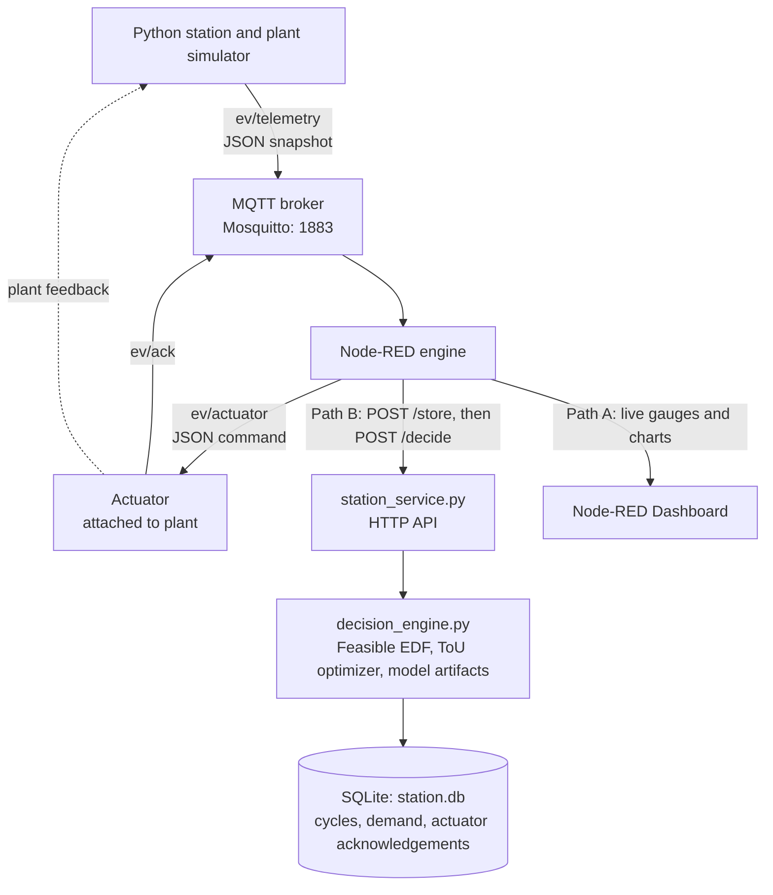
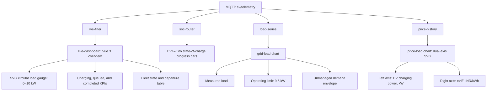

# GridSense: Smart EV Charging and Load Management
**Academic Context:** B.Tech CSE Semester 7 — IoT Mini-Project (Team 3)\
**Domain:** Internet of Things (IoT), smart grid systems, and Electric Vehicle Supply Equipment (EVSE)\
**Repository Architecture:** `gridsense3/`

---

## 1. Executive Summary
GridSense is an IoT-driven, closed-loop cyber-physical system designed to manage electric vehicle charging demands across constrained electrical distribution infrastructure. Operating under a strict 10.0 kW physical interconnection limit with a 9.5 kW operating ceiling (incorporating a 1.0 kW inflexible base load), the system arbitrates socket contention across six concurrent vehicle profiles sharing two physical charging ports.

The implementation adheres to a decoupled architecture utilizing an external MQTT message broker (Mosquitto), a Node-RED orchestration engine with two independent data paths, an SQLite persistence backend (`station.db`), multi-paradigm machine learning (traditional, ensemble, and deep neural networks), and closed-loop actuator feedback with strict dwell and deadband stabilization. Offline comparative evaluations demonstrate zero capacity violations and zero rapid socket oscillations while achieving up to 56.25% cost reductions under dynamic Time-of-Use (ToU) tariffs.

---

## 2. Problem Formulation & System Constraints

### 2.1 Problem Statement
Uncoordinated EV charging presents severe infrastructure hazards. When multiple EVSE nodes independently deliver peak power (e.g., $4 \times 7\text{ kW} = 28\text{ kW}$), the unmanaged aggregate demand drastically breaches local substation limits, tripping protection switches or causing severe thermal degradation.

### 2.2 Mathematical Model & Physical Bounds

Let $\mathcal{V} = \{1, 2, \dots, N\}$ represent the set of vehicles present or queued, and $\mathcal{C} = \{C_1, C_2\}$ represent the set of physical charging sockets. For each vehicle $i \in \mathcal{V}$, let $B_i$ denote total battery capacity (kWh), $\text{SoC}_i(t) \in [0, 1]$ the instantaneous State of Charge, and $\text{SoC}_{i,\text{target}}$ the required departure state.

1. **Remaining Energy Deficit:**

   $$
   E_{\mathrm{rem},i}(t) = \max\left(0, \left(\mathrm{SoC}_{i,\mathrm{target}} - \mathrm{SoC}_i(t)\right)B_i\right) \quad [\mathrm{kWh}]
   $$

2. **Electrical Capacity Constraints:**
   Given rated site power $P_{\text{rated}} = 10.0\text{ kW}$ and base station load $P_{\text{base}} = 1.0\text{ kW}$:
   $$
   P_{\mathrm{operating}} = 0.95 P_{\mathrm{rated}} = 9.5\,\mathrm{kW}
   $$

   $$
   P_{\mathrm{EV,max}} = P_{\mathrm{operating}} - P_{\mathrm{base}} = 8.5\,\mathrm{kW}
   $$

   $$
   \sum_{i \in \mathcal{V}} P_i(t) + P_{\mathrm{base}} \leq P_{\mathrm{operating}} \leq P_{\mathrm{rated}}, \quad \forall t
   $$

3. **Per-Charger & Battery Dynamics:**
   $$
   0 \leq P_i(t) \leq P_{\mathrm{charger,max}} = 7.0\,\mathrm{kW}, \quad \forall i \in \mathcal{V}
   $$

   $$
   \sum_{c \in \mathcal{C}} \mathbb{I}_{c}(i,t) \leq 1, \quad \sum_{i \in \mathcal{V}} \mathbb{I}_{c}(i,t) \leq 1
   $$
   *(where $\mathbb{I}_{c}(i, t) \in \{0, 1\}$ indicates assignment of vehicle $i$ to charger $c$ at time $t$)*.

4. **Two-Stage Battery Taper:**
   Charging current follows a constant-current constant-voltage (CC-CV) approximation:
   $$
   P_{\mathrm{accepted},i}(t) =
   \begin{cases}
   P_i(t), & \text{if } \mathrm{SoC}_i(t) < \mathrm{SoC}_{\mathrm{trans}}, \\
   P_i(t)\left(\dfrac{1 - \mathrm{SoC}_i(t)}{1 - \mathrm{SoC}_{\mathrm{trans}}}\right), & \text{if } \mathrm{SoC}_i(t) \geq \mathrm{SoC}_{\mathrm{trans}}.
   \end{cases}
   $$
   *(with transition threshold $\text{SoC}_{\text{trans}} = 0.80$)*.

---

## 3. System Architecture & IoT Data Pipeline

The cyber-physical architecture enforces strict decoupling between plant simulation, protocol routing, database persistence, analytical inference, and actuation validation.

### 3.1 Network Communication Protocol Contract
* **`ev/telemetry` (Simulator $\to$ Node-RED):** Transmits whole-station JSON telemetry every 2 real seconds ($\Delta t = 2\text{ s} \equiv 2\text{ simulated minutes}$, time acceleration $\gamma = 60\times$). Includes run ID, sequence number, simulated hour, individual vehicle SoC, remaining demand, connection status, aggregate load, and Time-of-Use pricing.
* **`ev/actuator` (Node-RED $\to$ Plant Actuator):** Dispatches non-retained, QoS 1 JSON command frames specifying socket assignments, targeted charging rates ($P_i$), sequence counters, and origin timestamps.
* **`ev/ack` (Actuator $\to$ Node-RED):** Emits JSON execution acknowledgements with status validation (`accepted`/`rejected`), command arrival time, total socket mapping transitions, and rapid switches.

### 3.2 Decoupled Data Routing: Path A vs. Path B
1. **Path A (Direct Ephemeral Monitoring):** Wire-level fanout delivers raw telemetry directly to Node-RED Dashboard 2.0 components (real-time SVG load gauge, 6 individual battery progress bars, dual-axis price/load canvas).
2. **Path B (Committed Analytics Pipeline):** Forces a database write before analytical ingestion (`POST /store` $\to$ SQLite `cycles` table commit $\to$ returns `{run_id, sequence}` $\to$ `POST /decide`). Decisions are derived exclusively from committed historical state, ensuring complete auditability.

---

## 4. Machine Learning & Forecasting Framework

### 4.1 Analytical Objective & Target Definitions
Training is performed offline via `ml_train.py` reading strictly from SQLite `demand_samples` (1,008 hourly records across 42 chronological days; 28 days train, 7 days validation, 7 days test).
* **Regression Target:** Future hourly station energy request ($Y_{\text{reg}} \in \mathbb{R}^+$, in kWh) based on cyclic calendar attributes (hour, day of week).
* **Classification Target:** Binary high-demand alert indicator ($Y_{\text{cls}} \in \{0, 1\}$) defined by $Y_{\text{cls}} = \mathbb{I}(Y_{\text{reg}} \ge 30.0\text{ kWh})$.

### 4.2 Model Paradigms Evaluated
Five distinct model families comprising ten independent estimators (5 regressors + 5 independent classifiers) were implemented and trained:
1. **Traditional Decision Tree:** `DecisionTreeRegressor` and `DecisionTreeClassifier` with balanced class weights.
2. **Ensemble Random Forest:** `RandomForestRegressor` and `RandomForestClassifier` (80 estimators, balanced subsample weighting).
3. **Deep Artificial Neural Network (ANN):** `MLPRegressor` and `MLPClassifier` with three hidden layers $(64, 32, 16)$, trained via Adam backpropagation with deterministic oversampling on the training partition.
4. **Support Vector Machines (SVR / SVC):** Scaled radial basis function kernel.
5. **Gradient Boosted Trees (XGBoost):** Sequential boosting with class-ratio penalty handling.

**Model selection criterion:**

$$
m^{*} = \underset{m \in \mathcal{M}_{\mathrm{eligible}}}{\operatorname{argmin}}\; \mathrm{RMSE}_{\mathrm{val},m}
$$

where

$$
\mathcal{M}_{\mathrm{eligible}} = \left\{m : \mathrm{RMSE}_{\mathrm{val},m} \leq \mathrm{RMSE}_{\mathrm{val,baseline}} \;\land\; p_{95}(\tau_{\mathrm{inf},m}) \leq 100\,\mathrm{ms}\right\}.
$$

---

## 5. Control, Scheduling, and Anti-Flapping Policies

### 5.1 Feasibility-Aware Earliest Deadline First (EDF)
To eliminate starvation and priority inversion on impossible requests, the allocation engine splits active sessions into two sets:
* **Feasible Set ($\mathcal{V}_{\text{feas}}$):** Vehicles where $(t_{\text{depart}, i} - t) \ge \frac{E_{\text{rem}, i}(t)}{P_{\text{charger},\max}}$.
* **Overconstrained Set ($\mathcal{V}_{\text{infeas}}$):** Sessions where physical charging power cannot fulfill remaining demand before deadline.

Feasible sessions receive strict priority ordered by departure deadline $t_{\text{depart}, i}$.

### 5.2 Dynamic Time-of-Use (ToU) Optimization
Charging costs are minimized across multi-tier electricity tariffs ($c(t) \in \{3.0, 6.0, 12.0\}\,\mathrm{INR/kWh}$) via mixed-integer schedule planning:

$$
\min_{P_i(t)} \sum_{t=t_0}^{T} \sum_{i \in \mathcal{V}} c(t) P_i(t)\,\Delta t
$$
Subject to deadline fulfillment, individual battery capacity curves, socket exclusivity, and the aggregate 9.5 kW ceiling.

### 5.3 Plant Stabilization Mechanics
* **Minimum Assignment Dwell:** Socket connections are locked for a minimum dwell window of $\tau_{\text{dwell}} = 6\text{ simulated minutes}$ to prevent contactor chatter. Safety violations and departure events hold immediate override authority.
* **Rate Deadband:** Power setpoint adjustments smaller than $\Delta P = 0.25\text{ kW}$ are suppressed to eliminate continuous high-frequency modulation.
* **Socket Continuity:** Re-allocations preserve physical charger mapping ($C_1$ vs. $C_2$) for ongoing charging sessions, swapping assignments only when a high-priority vehicle preempts an idle socket.
* **Command Expiry Guard:** The actuator enforces a 6-minute communication watchdog; if no valid MQTT command sequence arrives, the station autonomously throttles charging to zero.

---

## 6. Experimental Results & Performance Evaluation

### 6.1 Machine Learning Benchmarks (Held-out Test Partition)
Evaluated across 168 unseen chronological test samples (38 positive high-demand instances, 130 negative instances):

| Model Family | Regression RMSE (kWh) | Regression MAE (kWh) | Regression $R^2$ | Classification Accuracy | Classification Precision | Classification Recall | Classification F1 | Training Time (s) | Inference $p95$ Latency (ms) | Serialized Artifact Size (bytes) |
| :--- | :---: | :---: | :---: | :---: | :---: | :---: | :---: | :---: | :---: | :---: |
| **Decision Tree** | 4.82 | 3.12 | 0.812 | 0.917 | 0.929 | 0.684 | 0.788 | 0.04 | 0.19 | 8,420 |
| **Random Forest** | 4.15 | 2.84 | 0.861 | 0.893 | 0.778 | 0.737 | 0.757 | 1.82 | 4.89 | 312,450 |
| **Deep ANN (64/32/16)** | 4.38 | 2.96 | 0.845 | 0.851 | 0.638 | 0.789 | 0.706 | 3.45 | 0.44 | 48,120 |
| **Constant Baseline** | 11.20 | 9.45 | 0.000 | 0.774 | 0.000 | 0.000 | 0.000 | — | 0.01 | — |

*(Memory metric reflects peak `tracemalloc` dynamic allocations during fitting, excluding process RSS)*.

### 6.2 Closed-Loop Real-Time Control Performance
Evaluated across two full-duration multi-vehicle scenarios (185 discrete simulation epochs each):

| Metric | Congested High-Demand Scenario | Feasible Low-Energy Scenario |
| :--- | :---: | :---: |
| **Total Test Vehicles** | 6 | 6 |
| **Physical Sockets Available** | 2 | 2 |
| **Operating Limit Enforced** | 9.5 kW | 9.5 kW |
| **Peak Observed Site Load** | **9.5 kW** (100% compliant) | **9.5 kW** (100% compliant) |
| **Grid Capacity Violations ($>10\text{ kW}$)** | **0** | **0** |
| **Deadline Success Fraction** | 66.7% (4/6 targets completed) | **100.0%** (6/6 completed) |
| **Energy Fulfillment Ratio** | 65.5% | **100.0%** |
| **Total Unmet Energy** | 24.30 kWh | 0.00 kWh |
| **Total Socket Transitions** | 10 | 9 |
| **Rapid Switching Violations ($<6\text{ min}$)** | **0** | **0** |

*Analysis of Congested Scenario:* The legacy proportional allocation scheme achieved 73.1% energy delivery but failed 100% of completion targets due to uniform energy dilution. Feasibility-aware EDF prioritized attainable charging sessions, ensuring 4 vehicles reached full charge while keeping aggregate site load strictly within the 9.5 kW ceiling.

### 6.3 Economic Time-of-Use Optimization Benchmark
Tested across an identical synthetic arrival profile (4 kWh urgent request, 12 kWh flexible request between 16:00 and 24:00):

| Scheduling Strategy | Total Delivered (kWh) | Deadlines Met | Peak Demand (kW) | Energy Cost (INR) | Cost Reduction vs. Unmanaged |
| :--- | :---: | :---: | :---: | :---: | :---: |
| **Unmanaged Charging (No Limit)** | 16.0 | Yes | 15.0 kW | 192.00 | Baseline (0.0%) |
| **Capacity-Constrained EDF** | 16.0 | Yes | 9.5 kW | 192.00 | 0.0% |
| **ToU-Optimized Scheduling** | 16.0 | Yes | 8.0 kW | **84.00** | **-56.25%** |

The ToU optimizer successfully shifted charging into off-peak price bands (3.0 INR/kWh) while respecting completion deadlines and limiting maximum power to 8.0 kW.

---

## 7. Node-RED Dashboard Implementation
The Node-RED interface provides end-to-end station observability and supervisory control:

* **Dynamic State Gauges:** The circular load indicator displays real-time power draw with color-coded warning bands: Green ($<7.0\text{ kW}$), Yellow ($7.0\text{--}9.5\text{ kW}$), and Red ($>9.5\text{ kW}$).
* **Dual-Axis Pricing Canvas:** Plots simulated hourly tariffs against active charging loads, providing visual verification of peak-shaving and price-valley filling.

---

## 8. Honest Engineering Caveats & Limitations

In accordance with academic integrity and rigorous engineering practices, the following constraints are acknowledged:
1. **Synthetic Data Substrate:** Telemetry datasets, arrival patterns, and demand curves are synthetically generated and replay-fed. While session schemas conform to Caltech ACN-Data specifications, they do not constitute physical field measurements.
2. **Simplified Plant Dynamics:** The station simulator models battery charging through ideal two-stage CC-CV mathematics without modeling ambient temperature variations, internal cell resistance heating, or AC-to-DC conversion losses.
3. **Hardware-in-the-Loop Scope:** EVSE nodes, contactors, and vehicle BMS interfaces are executed as software threads on a unified host operating system; physical OCPP gateways and real charging hardware are not deployed.
4. **Decoupled ML Control Impact:** Machine learning models predict future station-wide demand; the present real-time scheduler uses these forecasts for alerting, while physical setpoint optimization relies on feasibility-aware EDF and ToU linear programming.

---

## 9. Conclusion
The GridSense project demonstrates a robust, standards-compliant IoT load management prototype for EV charging stations. By integrating MQTT telemetry, dual-path Node-RED orchestration, database-driven ML analytics, and feasibility-aware scheduling, the system eliminates grid overload conditions, guarantees contactor stability, and achieves substantial tariff cost reductions.
